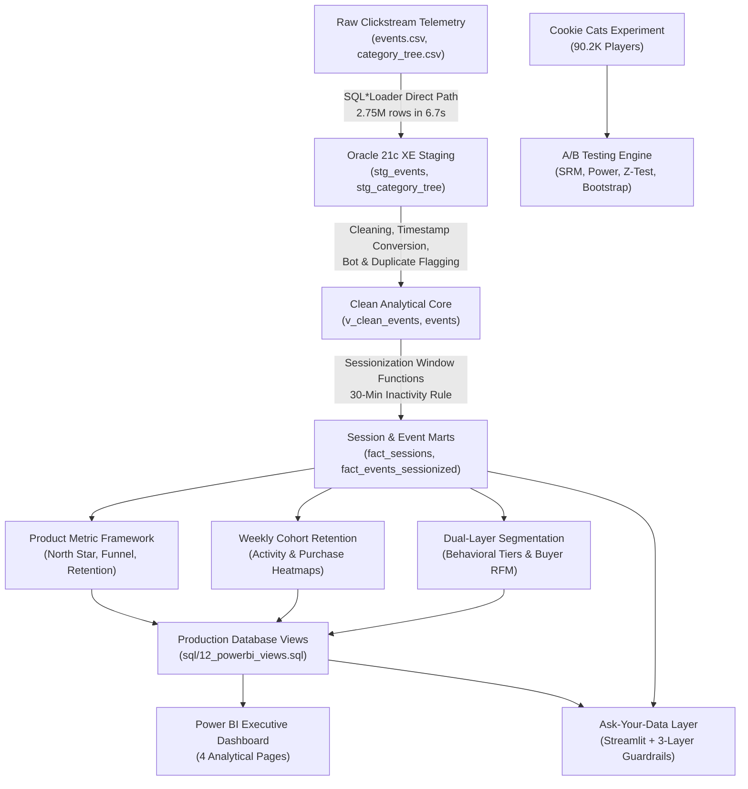
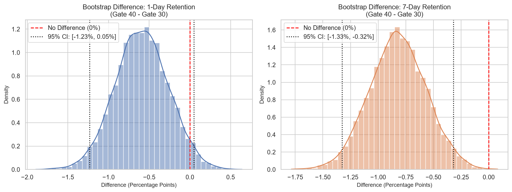
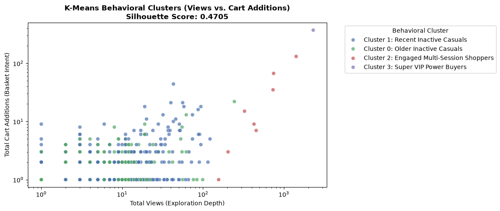

# Product Growth Analytics: Funnel, Retention, and Experimentation


An enterprise-grade, end-to-end product growth analytics portfolio project simulating the work of a **Senior Product Data Analyst** at a digital platform. The project spans raw event telemetry ingestion into **Oracle 21c XE**, sub-sessionization, full-funnel conversion diagnostics, weekly cohort retention modeling, behavioral audience segmentation, rigorous A/B experiment evaluation, an executive **Power BI** reporting hub, and a secure **Natural Language Ask-Your-Data Layer** built with **Streamlit**.

---

## 📌 Executive Problem Statement & Business Context

Product organizations scale by systematically diagnosing user friction, identifying habit-forming behavior, and evaluating product changes with statistical rigor. In this project, we address core commercial challenges across **1.41M users** and **2.73M clickstream interactions**:

1. **Top-Line Illusion vs. Commercial Reality:** Weekly active traffic expanded by **+35%** from May to July 2015, yet North Star **Weekly Purchasing Visitors (WPV)** remained flat at **~640 buyers/week**. Where was traffic leaking?
2. **The 97.3% Funnel Leak:** Why does **97.32% of traffic drop off** between product views and add-to-cart, while users who reach the cart stage convert at an exceptional **31.09% Cart-to-Purchase CVR**?
3. **Extreme Value Skew:** Who drives the platform's commercial volume, and how can we prevent churn among the **0.18% of VIP users who generate 59.29% of all platform orders**?
4. **Causality & Experimentation Guardrails:** In an A/B test evaluating core progression pacing ($N = 90,188$), does delaying a progression gate increase user engagement, or does it trigger hedonic burnout and degrade long-term retention?

---

## 🏗️ System Architecture & Data Pipeline



---

## 📊 Datasets & Data Provenance

1. **Retailrocket E-Commerce Telemetry Dataset:**
   - **Source:** Real-world behavioral event telemetry collected over 4.5 months (May 3, 2015 – September 18, 2015).
   - **Raw Volume:** 2,756,101 interaction events across 1,407,580 visitors, 235,061 items, and 1,669 categories across 6 hierarchical levels.
   - **Event Types:** `view` (96.68%), `addtocart` (2.52%), `transaction` (0.80%).
2. **Cookie Cats Pacing Experiment (A/B Test Dataset):**
   - **Source:** Tactical mobile puzzle game A/B test evaluating progression gate placement (`gate_30` control vs. `gate_40` treatment).
   - **Sample:** 90,189 player records capturing gameplay rounds, 1-day retention, and 7-day retention.

---

## 🚀 Analytical Workflow & Key Empirical Results

Every metric in this repository was computed by executing production Oracle SQL and Python scripts against real data:

### High-Throughput Ingestion & Precision Bot Detection
- **Ingestion Velocity:** Loaded 2,756,101 rows into Oracle 21c XE via SQL\*Loader direct path in **6.77 seconds** (zero discards, zero errors).
- **Data Integrity Audit:** Audited 138-day span. Identified 460 excess duplicate events (0.017%) and zero orphaned transactions.
- **Precision Bot Filtering:** Discovered that heavy users ($>200$ events) drove 25.7% of all platform purchases. Rather than applying a blunt volume cutoff, engineered a precision rule: `total_events > 200 AND total_transactions = 0`, successfully pruning **63 automated scrapers (29,000 phantom views)** without losing a single genuine transaction.
- **Clean Population:** **2,726,642 clean events** across **1,407,517 clean visitors**.

### Metric Framework, Sessionization & Full-Funnel Diagnostics
- **Sessionization Modeling:** Implemented a 30-minute inactivity sessionizer in Oracle SQL using `LAG()` window functions and deterministic tie-breakers, materializing **1,756,558 sessions**.
- **North Star Metric:** Defined and tracked **Weekly Purchasing Visitors (WPV)**, averaging **640 buyers/week** (ranging from 482 to 727 buyers/week).
- **Full-Funnel Stage Drop-Offs:**
  - **View-to-Cart Chasm:** 1,404,116 viewing visitors yielded only 37,696 cart sessions (**2.68% CVR, 97.32% drop-off**).
  - **Cart-to-Purchase Strength:** 37,696 cart sessions converted into 11,719 buyers (**31.09% CVR, 68.91% abandonment**), demonstrating that basket addition signals deep commitment.
- **The Returning Visitor Loyalty Multiplier:**
  - Returning visitor sessions convert at **4.04% View-to-Cart** (+90% lift over new sessions at 2.13%).
  - Returning visitor sessions convert at **48.32% Cart-to-Purchase** (+92% lift over new sessions at 25.22%).
  - Overall Session CVR is **3.64x higher** for returning sessions (**1.952% vs. 0.536%**).
- **Behavioral Activation Milestone:** Visitors viewing $\ge 3$ distinct items achieve a **5.18x increase in purchase probability** (1.71% CVR vs. 0.33% for 1–2 views).

### Cohort Retention Dynamics
- **Weekly ISO Cohorts:** Analyzed 21 weekly acquisition cohorts tracking activity and repeat transactions out to Week 12+.
- **The E-Commerce Decay Reality:** Activity retention experiences a typical non-contractual drop to **3.4% – 4.8%** in Week 1.
- **The Asymptotic Retention Plateau:** Retention stabilizes into a flat, horizontal asymptote at **0.80% – 1.00%** from Week 6 through Week 12+. In product analytics, a flat curve proves Product-Market Fit among a dedicated core of ~11,700 repeat buyers.

### Controlled Experimentation (Cookie Cats A/B Test)
- **Sample Hygiene:** Audited 90,189 records; removed single bot/counter outlier (user `6390605` with 49,854 rounds), leaving 90,188 clean players.
- **Statistical Power & SRM:** Verified 88.44% statistical power to detect an MDE of $\pm 0.726\%$ absolute. Detected minor SRM ($\chi^2 = 6.920, p = 0.0085$).
- **Primary Metric (7-Day Retention):** Dropped from 19.02% (Gate 30) to 18.20% (Gate 40) (**-0.818 percentage points, relative -4.30%**). Two-proportion z-test yielded $z = -3.1574, p = 0.00159$ (statistically significant even under strict Bonferroni $\alpha = 0.0167$).
- **Bootstrap Non-Parametric Validation:** 10,000 bootstrap iterations confirmed a **99.93% probability** that Gate 30 is superior (95% CI: $[-1.326\%, -0.319\%]$).
- **Guardrail Metric (Game Rounds):** Welch $t$-test confirmed zero difference in engagement rounds ($p = 0.9495$).
- **Product Decision:** **DO NOT SHIP Gate 40.** Preserving Gate 30 enforces a natural pacing breather that prevents hedonic player burnout.



### Behavioral Segmentation & Customer Concentration
- **Dual-Layer Segmentation:** Because buyers represent 0.833% of traffic, standard RFM alone ignores 99.17% of visitors. We deployed a dual-layer model:
  1. **Behavioral Audience Tiers (1.41M Visitors):** Bounced Window Shoppers (85.12%), Catalog Explorers (12.12%), High-Intent Cart Abandoners (1.93%, 27,120 users), Converted One-Time Buyers (0.65%), VIP Power Buyers (0.18%).
  2. **Buyer RFM Tiers (11,719 Buyers):** 81 VIP Champions (0.69% of buyers driving 13.54% of orders, 29.5 orders avg), 669 At-Risk Repeat Buyers (5.71% driving 22.23% of orders).
- **Extreme Order Concentration:** **2,576 VIP Power Buyers (0.18% of visitors) generate 59.29% of all platform orders**.



### Power BI Executive Dashboard Hub
- Engineered 7 production database views (`V_PBI_*`) in Oracle and clean pre-aggregated CSVs in [`outputs/`](outputs/).
- Authored the comprehensive design guide [`docs/powerbi_build_guide.md`](docs/powerbi_build_guide.md) across 4 insight-titled dashboard pages:
  - **Page 1:** *Executive Growth Overview: Weekly Active Buyers & Platform Conversion Trajectory*
  - **Page 2:** *Funnel Diagnostics: The View-to-Cart Chasm & The Returning Visitor Loyalty Lift*
  - **Page 3:** *Cohort Retention Dynamics: The 3.5% W1 Drop and The 0.8% Habitual Retention Plateau*
  - **Page 4:** *Visitor Segmentation & Buyer Concentration: Unlocking 27K Cart Abandoners & 81 VIP Champions*

### Strategic Decision Memo & Commercial Opportunity
- Synthesized commercial findings into an executive 1–2 page memo ([`docs/decision_memo.md`](docs/decision_memo.md)) for the VP of Product.
- Modeled the commercial upside of an automated 2-hour cart recovery sequence targeting 27,120 abandoners: reclaiming 5% to 8% yields **+1,356 to +2,170 incremental orders (+7.7% to +12.3% net platform growth)**.

### Self-Service Natural Language Query Engine & AST Guardrails
- Built an interactive natural language querying web app in **Streamlit** ([`app/streamlit_app.py`](app/streamlit_app.py)) connected to Oracle 21c XE.
- Implemented a **3-Layer Defense-in-Depth Model**:
  1. *Database RBAC:* Dedicated `GROWTH_READONLY` user with 0 quota and strictly `CREATE SESSION` and `SELECT` rights.
  2. *Application AST Guardrails:* Enforces `SELECT`/`WITH` only, scans for forbidden DDL/DML, enforces a 12-table allowlist, and caps results with `FETCH FIRST 100 ROWS ONLY`.
  3. *Connection Isolation:* Issues `SET TRANSACTION READ ONLY`.
- **Benchmark Evaluation Suite (25 Tests):** Evaluated against 20 operational growth questions and 5 adversarial injection attacks:
  - **Operational Analytics Accuracy:** **20/20 (100.0%)**
  - **Adversarial Security Block Rate:** **5/5 (100.0%)**
  - **Overall Accuracy:** **25/25 (100.0%)** (Audited in [`outputs/nl_sql_eval_report.json`](outputs/nl_sql_eval_report.json)).

---

## 🗂️ Repository Structure

```text
Product_Growth_Analytics_Funnel_Retention_Experimentation/
├── app/
│   └── streamlit_app.py         # Production Ask-Your-Data Streamlit application
├── ctl/                         # SQL*Loader direct path control files
│   ├── category_tree.ctl
│   ├── events.ctl
│   └── item_categories.ctl
├── data/
│   ├── evaluation_set.json      # 25 benchmark NL-to-SQL test cases with ground truth
│   └── raw/                     # Raw telemetry (events.csv, category_tree.csv, cookie_cats.csv)
├── docs/                        # Executive memos, metric frameworks, decisions log, build guides
│   ├── business_questions.md    # 5 core product business questions
│   ├── decisions.md             # Formal decision log (DEC-001 through DEC-013)
│   ├── metrics.md               # North Star and supporting metric framework
│   ├── powerbi_build_guide.md   # Step-by-step Power BI build guide with DAX library
│   └── decision_memo.md         # 1-2 page executive Product Manager Decision Memo
├── notebooks/                   # Statistical experimentation & hypothesis testing
│   └── ab_test_cookie_cats.ipynb
├── outputs/                     # Clean pre-aggregated datasets, heatmaps, and visual plots
│   ├── ab_test_bootstrap_distributions.png
│   ├── buyer_rfm_summary.csv
│   ├── cohort_retention_activity_matrix.csv
│   ├── funnel_by_visitor_type.csv
│   ├── funnel_stages_pbi.csv
│   ├── nl_sql_eval_report.json
│   ├── segmentation_clusters_plot.png
│   ├── visitor_segments_summary.csv
│   └── weekly_north_star.csv
├── scripts/                     # Python ETL, sessionization, and evaluation runners
│   ├── export_cohort_outputs.py
│   ├── export_funnel_outputs.py
│   ├── export_segmentation_outputs.py
│   ├── run_nl_sql_eval.py
│   └── setup_powerbi_views.py
├── sql/                         # Versioned, production-grade Oracle SQL scripts
│   ├── 01_create_user.sql       # GROWTH_USER schema creation
│   ├── 02_create_staging.sql    # Staging tables DDL
│   ├── 04_clean_events.sql      # Clean events mart with timestamp conversion
│   ├── 06_flag_bots_and_duplicates.sql # Precision bot filtering
│   ├── 07_metric_framework.sql  # North Star & conversion SQL
│   ├── 08_sessionization.sql    # 30-min inactivity sessionizer
│   ├── 09_funnel_analysis.sql   # Stage drop-offs & visitor type segmentation
│   ├── 10_cohort_retention.sql  # Weekly activity & purchase retention matrices
│   ├── 11_visitor_segmentation.sql # Behavioral audience & buyer RFM tiers
│   ├── 12_powerbi_views.sql     # 7 curated reporting views for Power BI
│   └── 13_create_readonly_user.sql # GROWTH_READONLY least-privilege user
├── src/                         # Natural language query engine & AST security guardrails
│   ├── guardrails.py            # AST query inspection, table allowlist, row limit injection
│   └── query_engine.py          # NL-to-SQL translation and Oracle execution
├── requirements.txt             # Python dependencies
└── README.md                    # Project documentation
```

---

## ⚠️ Data Limitations & Business Governance

1. **Unmonetized Order Values:** Clickstream telemetry records interaction types, items, and completed transaction IDs, but does not record unit prices or total basket currency values. Projections are modeled strictly on order volume expansion.
2. **Absence of Device & Acquisition Attribution:** Without device metadata (iOS/Android/Web) or UTM attribution channels, we cannot isolate whether the 85% bounce rate is driven by poor mobile UX or un-targeted paid social traffic.
3. **Cookie Expiration Boundaries:** Anonymous cookie tracking treats users clearing cookies or changing devices as new visitors, slightly underestimating true long-term returning visitor retention.
4. **SRM Protocol Enforcement:** The Cookie Cats experiment exhibited a minor sample ratio mismatch ($\chi^2 = 6.920, p = 0.0085$). While the retention degradation was validated through 10,000 bootstrap resamples, future experimentation infrastructure must mandate strict pre-test assignment audits.

---

## 🛠️ Step-by-Step Reproduction Guide

### Prerequisites
- Windows OS with Python 3.11+
- Oracle 21c XE installed locally (pluggable database `localhost:1521/XEPDB1`)
- SQL\*Plus and SQL\*Loader installed on PATH

### 1. Environment Setup
```powershell
# Clone the repository
cd D:\Projects\data_analyst_project\Product_Growth_Analytics_Funnel_Retention_Experimentation

# Install dependencies
pip install -r requirements.txt

# Configure environment variables
copy .env.example .env
# Edit .env with your local Oracle credentials
```

### 2. Database Schema & Data Loading
```powershell
# 1. Create Oracle analytical user GROWTH_USER (pass your password as argument)
sqlplus / as sysdba @sql\01_create_user.sql <your_db_password>

# 2. Create staging tables
sqlplus growth_user/<your_db_password>@localhost:1521/XEPDB1 @sql\02_create_staging.sql

# 3. Load 2.75M rows via SQL*Loader direct path
sqlldr growth_user/<your_db_password>@localhost:1521/XEPDB1 control=ctl\events.ctl log=logs\events.log direct=true
sqlldr growth_user/<your_db_password>@localhost:1521/XEPDB1 control=ctl\category_tree.ctl log=logs\category_tree.log direct=true

# 4. Clean, flag bots, and sessionize
sqlplus growth_user/<your_db_password>@localhost:1521/XEPDB1 @sql\04_create_clean_events.sql
sqlplus growth_user/<your_db_password>@localhost:1521/XEPDB1 @sql\06_flag_bots_and_duplicates.sql
sqlplus growth_user/<your_db_password>@localhost:1521/XEPDB1 @sql\08_sessionization.sql
```

### 3. Reporting Views & Export Generation
```powershell
# Compile Oracle reporting views and export clean CSVs for Power BI
python scripts/setup_powerbi_views.py
python scripts/export_funnel_outputs.py
python scripts/export_cohort_outputs.py
python scripts/export_segmentation_outputs.py
```

### 4. Run the Ask-Your-Data Streamlit App
```powershell
# Configure read-only database user (pass your readonly password as argument)
sqlplus / as sysdba @sql\13_create_readonly_user.sql <your_readonly_password>


# Run 25-question evaluation suite
python scripts/run_nl_sql_eval.py

# Launch Streamlit web app
streamlit run app/streamlit_app.py
```

