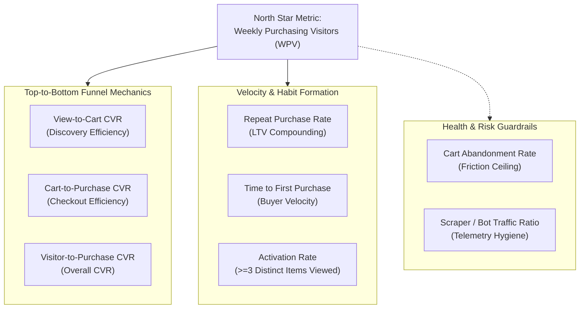

# Growth Metric Framework

## Project: Product Growth Analytics: Funnel, Retention and Experimentation
**Platform:** Retailrocket E-Commerce Event Telemetry  
**Audited Dataset Window:** May 3, 2015 – September 18, 2015 (138 calendar days)  
**Curated Base Volume:** 1,407,517 unique visitors | 2,726,642 events | 17,672 unique transactions  

---

## Executive Summary & Metric Hierarchy

A sustainable growth engine balances top-of-funnel discovery, checkout velocity, customer retention, and traffic integrity. This framework establishes an unambiguous hierarchy of metrics for product managers, growth engineers, and leadership.



---

## 1. North Star Metric: Weekly Purchasing Visitors (WPV)

### Definition
The number of distinct, non-bot visitors who complete at least one transactional purchase within a standard ISO calendar week (Monday to Sunday).

$$\text{WPV}_w = \big| \{ v \in \text{Visitors}_w \mid \exists \, e \in \text{Events}_{v, w} \text{ where } e.\text{event\_type} = \text{'transaction'} \} \big|$$

### Product Justification & Intuition
- **Customer Value Realization:** In e-commerce, views and cart adds represent *intent*, but transactions represent *captured value* and customer commitment.
- **Weekly Rhythm:** E-commerce exhibits strong day-of-week seasonality (surges on weekdays vs. weekends). A weekly grain smooths cyclical noise while providing rapid feedback for sprint experiments.
- **Deters Vanity Optimization:** Unlike Gross Merchandise Value (GMV) or total transaction count, which can be distorted by a handful of wholesale accounts placing dozens of orders, WPV measures **broad customer adoption**.

### Production SQL (Oracle 21c)
```sql
SELECT 
    TRUNC(event_date, 'IW') AS week_start,
    COUNT(DISTINCT visitorid) AS weekly_active_visitors,
    COUNT(DISTINCT CASE WHEN event_type = 'transaction' THEN visitorid END) AS weekly_purchasing_visitors,
    COUNT(CASE WHEN event_type = 'transaction' THEN 1 END) AS weekly_transaction_events,
    COUNT(DISTINCT transactionid) AS weekly_unique_orders,
    ROUND(
        COUNT(DISTINCT CASE WHEN event_type = 'transaction' THEN visitorid END) * 100.0 / 
        NULLIF(COUNT(DISTINCT visitorid), 0), 
        3
    ) AS weekly_buyer_conversion_rate
FROM v_clean_events
GROUP BY TRUNC(event_date, 'IW')
ORDER BY week_start;
```

### Measured Baseline Results (Full 21-Week Trajectory)
| Week Start | Weekly Active Visitors (WAU) | Weekly Purchasing Visitors (WPV) | Weekly Orders | Weekly Buyer CVR |
| :--- | :---: | :---: | :---: | :---: |
| **2015-04-27** *(Partial)* | 7,862 | 52 | 70 | 0.661% |
| **2015-05-04** | 72,115 | 648 | 902 | 0.899% |
| **2015-05-11** | 80,382 | 712 | 940 | 0.886% |
| **2015-05-18** | 83,900 | 607 | 868 | 0.723% |
| **2015-05-25** | 79,165 | 639 | 907 | 0.807% |
| **2015-06-01** | 79,246 | 657 | 931 | 0.829% |
| **2015-06-08** | 73,148 | 517 | 767 | 0.707% |
| **2015-06-15** | 76,963 | 722 | 1,024 | 0.938% |
| **2015-06-22** | 75,938 | 695 | 1,020 | 0.915% |
| **2015-06-29** | 75,799 | 625 | 881 | 0.825% |
| **2015-07-06** | 92,580 | 697 | 992 | 0.753% |
| **2015-07-13** | 89,151 | 651 | 931 | 0.730% |
| **2015-07-20** | 97,580 | 683 | 1,033 | 0.700% |
| **2015-07-27** *(Peak)* | 82,210 | **727** | **1,051** | 0.884% |
| **2015-08-03** | 75,436 | 612 | 853 | 0.811% |
| **2015-08-10** *(Trough)* | 72,246 | **482** | 708 | 0.667% |
| **2015-08-17** | 73,781 | 636 | 918 | 0.862% |
| **2015-08-24** | 74,118 | 631 | 894 | 0.851% |
| **2015-08-31** | 70,716 | 511 | 707 | 0.723% |
| **2015-09-07** | 81,006 | 638 | 867 | 0.788% |
| **2015-09-14** *(Partial)* | 38,562 | 274 | 408 | 0.711% |

**Empirical Summary:** Normal weekly purchasing volume averages **640 buyers/week**, peaking at **727** and dipping to **482**. Weekly conversion hovers between **0.67% and 0.94%**.

---

## 2. Supporting Funnel & Conversion Metrics

```text
Full Lifecycle Funnel:
1,407,517 Clean Visitors
   └── 1,404,116 Viewed Item (99.76%)
          └── 37,696 Added to Cart (2.68% View-to-Cart)
                 └── 11,719 Completed Purchase (31.09% Cart-to-Purchase | 0.833% Overall CVR)
```

### A. View-to-Cart Conversion Rate (Discovery Efficiency)
- **Formula:** $\frac{\text{Visitors with } \ge 1 \text{ Cart Add}}{\text{Visitors with } \ge 1 \text{ View}} \times 100$
- **Justification:** Measures product discovery, relevance of search results, pricing competitiveness, and product page appeal.
- **Measured Value:** **2.68%** (37,696 cart-adding visitors / 1,404,116 viewing visitors).
- **Product Implication:** 97.32% of viewing visitors never add an item to their cart. This is the **primary leakage point** in the customer journey.

### B. Cart-to-Purchase Conversion Rate (Checkout Efficiency)
- **Formula:** $\frac{\text{Visitors with } \ge 1 \text{ Purchase}}{\text{Visitors with } \ge 1 \text{ Cart Add}} \times 100$
- **Justification:** Measures checkout usability, payment friction, shipping cost transparency, and cart trust.
- **Measured Value:** **31.09%** (11,719 purchasing visitors / 37,696 cart visitors).
- **Product Implication:** Once a visitor clears the hurdle of adding an item to their cart, almost a third complete checkout.

### C. Overall Visitor-to-Purchase Conversion Rate
- **Formula:** $\frac{\text{Purchasing Visitors}}{\text{Total Visitors}} \times 100$
- **Justification:** High-level platform conversion efficiency benchmark.
- **Measured Value:** **0.833%** (~0.83%). Out of every 1,000 unique visitors, 8.3 visitors make a purchase.

### Production SQL
```sql
WITH visitor_milestones AS (
    SELECT 
        visitorid,
        MAX(CASE WHEN event_type = 'view' THEN 1 ELSE 0 END) AS has_view,
        MAX(CASE WHEN event_type = 'addtocart' THEN 1 ELSE 0 END) AS has_cart,
        MAX(CASE WHEN event_type = 'transaction' THEN 1 ELSE 0 END) AS has_purchase
    FROM v_clean_events
    GROUP BY visitorid
)
SELECT 
    COUNT(*) AS total_visitors,
    SUM(has_view) AS viewing_visitors,
    SUM(has_cart) AS carting_visitors,
    SUM(has_purchase) AS purchasing_visitors,
    ROUND(SUM(has_cart) * 100.0 / NULLIF(SUM(has_view), 0), 2) AS view_to_cart_cvr_pct,
    ROUND(SUM(has_purchase) * 100.0 / NULLIF(SUM(has_cart), 0), 2) AS cart_to_purchase_cvr_pct,
    ROUND(SUM(has_purchase) * 100.0 / COUNT(*), 3) AS visitor_to_purchase_cvr_pct
FROM visitor_milestones;
```

---

## 3. Customer Lifetime & Velocity Metrics

### A. Repeat Purchase Rate (RPR)
- **Formula:** $\frac{\text{Buyers with } \ge 2 \text{ Distinct Orders}}{\text{Total Distinct Buyers}} \times 100$
- **Justification:** Growth through acquisition alone is capital-inefficient. RPR reveals whether the platform fosters habit formation and long-term customer value.
- **Measured Baseline:**
  - Total Buyers: **11,719**
  - Single-Order Buyers: **10,656 (90.93%)**
  - Repeat Buyers: **1,063 (9.07%)**
  - **Repeat Purchase Rate:** **9.07%**
  - Average Orders per Buyer: **1.51**

#### Order Frequency Concentration Analysis
| Order Bucket | Buyer Count | % of Buyers | Total Orders | % of Platform Orders |
| :--- | :---: | :---: | :---: | :---: |
| **1 Order (One-Time)** | 10,656 | 90.93% | 10,656 | 60.30% |
| **2 Orders** | 748 | 6.38% | 1,496 | 8.47% |
| **3 Orders** | 133 | 1.13% | 399 | 2.26% |
| **4 Orders** | 44 | 0.38% | 176 | 1.00% |
| **5–9 Orders** | 48 | 0.41% | 317 | 1.79% |
| **10+ Orders (Power Buyers)** | **90** | **0.77%** | **4,628** | **26.19%** |

> [!IMPORTANT]
> **Power Buyer Concentration Insight:**
> While only 9.07% of buyers ever repeat, **a tiny cadre of 90 power buyers (0.77% of all buyers) generates 26.19% of all platform orders**. Retaining and servicing these power accounts is as critical as acquiring thousands of one-time shoppers.

### B. Time to First Purchase (Buyer Velocity)
- **Formula:** Hours elapsed between a visitor's very first recorded interaction on the platform and their first purchase:
  $$\Delta t = t_{\text{first\_txn}} - t_{\text{first\_event}}$$
- **Justification:** Determines retargeting urgency and promotional discount windows.
- **Measured Baseline:**
  - **Median Time to Purchase:** **0.31 hours (~18.6 minutes)**
  - 25th Percentile (p25): **0.10 hours (6.0 minutes)**
  - 75th Percentile (p75): **4.60 hours**
  - 90th Percentile (p90): **170.92 hours (~7.1 days)**
  - Mean Time to Purchase: **91.06 hours (~3.8 days)** (heavily pulled up by long-tail re-visitors)
  - **% Purchased Within 1 Hour:** **65.93%**
  - **% Purchased Same Day (< 24 Hours):** **81.61%**

```text
Cumulative Purchase Timing Distribution:
0 min ──────── 18.6 min (Median: 50%) ────── 1 hr (65.9%) ────── 24 hrs (81.6%) ────── 7+ days (10%)
```

- **Product Implication:** E-commerce purchasing is overwhelmingly **spontaneous and high-velocity**. Over 81% of buyers complete their order on the very first day. If a visitor does not buy within 24 hours, automated triggered cart reminders must deploy within 2-4 hours to capture remaining intent.

### Production SQL
```sql
WITH visitor_journey AS (
    SELECT 
        visitorid,
        MIN(event_time) AS first_event_time,
        MIN(CASE WHEN event_type = 'transaction' THEN event_time END) AS first_txn_time
    FROM v_clean_events
    GROUP BY visitorid
    HAVING COUNT(CASE WHEN event_type = 'transaction' THEN 1 END) > 0
),
journey_diffs AS (
    SELECT 
        visitorid,
        ROUND((CAST(first_txn_time AS DATE) - CAST(first_event_time AS DATE)) * 24, 2) AS hours_to_first_txn,
        ROUND(CAST(first_txn_time AS DATE) - CAST(first_event_time AS DATE), 2) AS days_to_first_txn
    FROM visitor_journey
)
SELECT 
    COUNT(*) AS total_buyers,
    ROUND(AVG(hours_to_first_txn), 2) AS mean_hours_to_txn,
    MEDIAN(hours_to_first_txn) AS median_hours_to_txn,
    PERCENTILE_CONT(0.25) WITHIN GROUP (ORDER BY hours_to_first_txn) AS p25_hours,
    PERCENTILE_CONT(0.75) WITHIN GROUP (ORDER BY hours_to_first_txn) AS p75_hours,
    PERCENTILE_CONT(0.90) WITHIN GROUP (ORDER BY hours_to_first_txn) AS p90_hours,
    ROUND(SUM(CASE WHEN hours_to_first_txn < 1 THEN 1 ELSE 0 END) * 100.0 / COUNT(*), 2) AS pct_purchased_within_1_hour,
    ROUND(SUM(CASE WHEN days_to_first_txn < 1 THEN 1 ELSE 0 END) * 100.0 / COUNT(*), 2) AS pct_purchased_same_day
FROM journey_diffs;
```

---

## 4. Activation Definition & Empirical Validation

### Definition of "Activated Visitor"
In digital products, an activated user has experienced the platform's core value proposition ("Aha! moment"). In content or social platforms, it might be adding 5 friends; in e-commerce, **browsing breadth and basket intent** signify true activation.

We evaluate two distinct activation tiers:
1. **Tier 1: Exploration Activation:** A visitor explores **$\ge 3$ distinct items**.
2. **Tier 2: Intent Activation:** A visitor executes **$\ge 1$ Add-to-Cart**.

### Empirical Validation of Activation Criteria
| Visitor Cohort | Visitor Count | % of All Traffic | Buyers | Conversion Rate (CVR) | Relative Lift vs. Baseline |
| :--- | :---: | :---: | :---: | :---: | :---: |
| **All Clean Visitors** | 1,407,517 | 100.0% | 11,719 | **0.833%** | 1.0x (Baseline) |
| **Bounced (1 View Only)** | 999,300 | 71.00% | 316 | **0.032%** | **0.04x** (-96% degradation) |
| **Tier 1 Activated ($\ge 3$ Items Viewed)** | 117,467 | 8.35% | 5,073 | **4.319%** | **5.18x Lift** |
| **Tier 2 Activated ($\ge 1$ Add-to-Cart)** | 37,696 | 2.68% | 10,576 | **28.056%** | **33.68x Lift** |

### Product Justification
- **71% of site traffic bounces after a single product view** with virtually zero conversion (0.032%).
- Nudging a visitor to view just **3 distinct items** increases their purchase probability **by over 500%** (from 0.83% to 4.32%).
- **Primary Product Goal:** Design discovery features (related products, "frequently bought together", category carousels) specifically optimized to move users from 1 view to $\ge 3$ views.

### Production SQL
```sql
WITH visitor_behavior AS (
    SELECT 
        visitorid,
        COUNT(CASE WHEN event_type = 'view' THEN 1 END) AS view_count,
        COUNT(DISTINCT itemid) AS distinct_items_viewed,
        MAX(CASE WHEN event_type = 'addtocart' THEN 1 ELSE 0 END) AS has_cart,
        MAX(CASE WHEN event_type = 'transaction' THEN 1 ELSE 0 END) AS has_purchased
    FROM v_clean_events
    GROUP BY visitorid
)
SELECT 
    'All Visitors' AS cohort,
    COUNT(*) AS total_visitors,
    SUM(has_purchased) AS buyers,
    ROUND(SUM(has_purchased) * 100.0 / COUNT(*), 3) AS cvr_pct
FROM visitor_behavior
UNION ALL
SELECT 
    'Bounced (1 view only)' AS cohort,
    COUNT(*) AS total_visitors,
    SUM(has_purchased) AS buyers,
    ROUND(SUM(has_purchased) * 100.0 / COUNT(*), 3) AS cvr_pct
FROM visitor_behavior
WHERE view_count = 1 AND has_cart = 0
UNION ALL
SELECT 
    'Activated: Explored >= 3 Distinct Items' AS cohort,
    COUNT(*) AS total_visitors,
    SUM(has_purchased) AS buyers,
    ROUND(SUM(has_purchased) * 100.0 / COUNT(*), 3) AS cvr_pct
FROM visitor_behavior
WHERE distinct_items_viewed >= 3
UNION ALL
SELECT 
    'Activated: Added Item to Cart (>= 1 Cart)' AS cohort,
    COUNT(*) AS total_visitors,
    SUM(has_purchased) AS buyers,
    ROUND(SUM(has_purchased) * 100.0 / COUNT(*), 3) AS cvr_pct
FROM visitor_behavior
WHERE has_cart = 1;
```

---

## 5. Guardrail Metrics

A growth initiative that increases top-line conversions while degrading customer experience, payment health, or data integrity is a false victory. We establish two guardrails:

### Guardrail 1: Visitor Cart Abandonment Rate
- **Formula:** $\frac{\text{Carting Visitors who Did Not Purchase}}{\text{Total Carting Visitors}} \times 100$
- **Justification:** If marketing runs aggressive flash discounts that inflate cart additions without addressing shipping transparency or checkout friction, cart abandonment will spike.
- **Measured Baseline:**
  - Total Cart Visitors: **37,696**
  - Purchasing Cart Visitors: **10,576**
  - Abandoned Cart Visitors: **27,120**
  - **Cart Abandonment Rate:** **71.94%**
- **Threshold Limit:** Alert if monthly abandonment exceeds **75.0%**.

### Guardrail 2: Telemetry Integrity & Scraper Ratio
- **Formula:** $\frac{\text{Bot / Scraper Events}}{\text{Total Ingested Events}} \times 100$
- **Justification:** Ensures that traffic growth reported to executives reflects authentic human demand rather than aggressive scraping activity.
- **Measured Baseline:** **1.05%** (29,000 bot events / 2,756,101 raw events).
- **Threshold Limit:** Alert if bot traffic ratio exceeds **3.0%**.

### Production SQL
```sql
WITH cart_users AS (
    SELECT 
        visitorid,
        MAX(CASE WHEN event_type = 'addtocart' THEN 1 ELSE 0 END) AS added_to_cart,
        MAX(CASE WHEN event_type = 'transaction' THEN 1 ELSE 0 END) AS purchased
    FROM v_clean_events
    GROUP BY visitorid
    HAVING MAX(CASE WHEN event_type = 'addtocart' THEN 1 ELSE 0 END) = 1
)
SELECT 
    COUNT(*) AS total_cart_visitors,
    SUM(purchased) AS purchasing_cart_visitors,
    COUNT(*) - SUM(purchased) AS abandoned_cart_visitors,
    ROUND((COUNT(*) - SUM(purchased)) * 100.0 / COUNT(*), 2) AS visitor_cart_abandonment_rate_pct
FROM cart_users;
```

---

## Summary Metric Dictionary for Interview Reference

| Metric Name | Level | Category | Benchmark Value | Formula Summary |
| :--- | :---: | :---: | :---: | :--- |
| **Weekly Purchasing Visitors (WPV)** | Weekly | **North Star** | **~640 / week** (Range: 482 - 727) | `COUNT(DISTINCT buyer) GROUP BY week` |
| **View-to-Cart CVR** | Visitor | Supporting | **2.68%** | `Cart Visitors / View Visitors` |
| **Cart-to-Purchase CVR** | Visitor | Supporting | **31.09%** | `Purchasing Visitors / Cart Visitors` |
| **Visitor-to-Purchase CVR** | Visitor | Supporting | **0.833%** | `Purchasing Visitors / All Visitors` |
| **Repeat Purchase Rate** | Buyer | Loyalty | **9.07%** | `Buyers with >= 2 Orders / Total Buyers` |
| **Time to First Purchase** | Buyer | Velocity | **0.31 hrs (Median)** / **81.6% same-day** | `t_purchase - t_first_event` |
| **Exploration Activation CVR** | Visitor | Activation | **4.32%** (5.2x lift) | CVR for visitors viewing $\ge 3$ distinct items |
| **Intent Activation CVR** | Visitor | Activation | **28.06%** (33.7x lift) | CVR for visitors adding $\ge 1$ item to cart |
| **Cart Abandonment Rate** | Visitor | **Guardrail** | **71.94%** | `1 - (Purchasing Cart Visitors / Cart Visitors)` |
| **Scraper Traffic Ratio** | Event | **Guardrail** | **1.05%** | `Bot Events / Total Ingested Events` |
